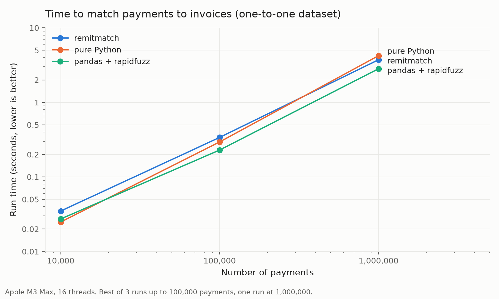

# remitmatch

A Python library with a Rust core (PyO3) that matches bank payments to open invoices,
including split and grouped payments (1:1, 1:N and N:1), and explains every match with a
per-signal score. Remittance matching is the accounts-receivable term for linking an
incoming payment to the invoices it settles.

**Status:** alpha. `0.1.0a3` is the current pre-release. The API may still change before
`0.1.0`, and accuracy has only been measured on synthetic data, so read
[Before you rely on it](#before-you-rely-on-it) first.

## Quick start

### 1. Install

```bash
pip install --pre remitmatch
```

`--pre` is needed while the only usable release is a pre-release. Python 3.10 or newer; wheels
are built for Linux (x86_64, aarch64), macOS (x86_64, arm64) and Windows (x64), so no Rust
toolchain is required.

### 2. Describe invoices and payments

Amounts are integers in minor units (cents), never floats. `scope` is a partition key such as
a company or tenant id: rows in different scopes, or in different currencies, never match.

### 3. Reconcile

`reconcile` takes the open invoices, the payments received and an optional `MatchConfig`.

### 4. Act on the result

Apply `auto` matches, send `suggested` and `ambiguous` ones to a person, and handle what is
left unmatched.

```python
from datetime import date

from remitmatch import Invoice, MatchConfig, MatchStatus, Payment, reconcile

invoices = [
    # Invoice(id, number, amount_minor, currency, issue_date, due_date, counterparty, scope)
    Invoice("i1", "INV-001", 60_000, "EUR", date(2024, 3, 1), date(2024, 3, 31), "Acme S.L.", "t1"),
    Invoice("i2", "INV-002", 40_000, "EUR", date(2024, 3, 5), date(2024, 3, 31), "Acme S.L.", "t1"),
    Invoice("i3", "INV-003", 12_500, "EUR", date(2024, 3, 7), date(2024, 4, 6), "Beta Corp", "t1"),
    Invoice("i4", "INV-004", 8_000, "EUR", date(2024, 3, 9), date(2024, 4, 8), "Gamma GmbH", "t1"),
]
payments = [
    # Payment(id, amount_minor, currency, value_date, reference, counterparty, scope)
    Payment("p1", 99_880, "EUR", date(2024, 3, 28), "Payment INV-001 INV-002", "ACME", "t1"),
    Payment("p2", 12_500, "EUR", date(2024, 4, 5), "inv 003", "BETA CORP", "t1"),
    Payment("p3", 8_000, "EUR", date(2024, 4, 8), "TRANSFER 000123", "GAMMA", "t1"),
]

# Accept up to 1.50 of difference per match, for example bank fees.
result = reconcile(invoices, payments, MatchConfig(amount_tolerance_minor=150))

for match in result.matches:
    action = "apply" if match.status is MatchStatus.AUTO else "review"
    print(action, match.kind.value, match.payment_ids, "->", match.invoice_ids)
    signals = {name: round(value, 2) for name, value in match.breakdown.items()}
    print("  score", round(match.score, 2), "residual", match.residual_minor, signals)
print("unmatched payments:", result.unmatched_payments)
print("unmatched invoices:", result.unmatched_invoices)
```

Output:

```text
apply 1:1 ('p2',) -> ('i3',)
  score 1.0 residual 0 {'amount': 1.0, 'date': 1.0, 'name': 1.0, 'reference': 1.0}
review 1:N ('p1',) -> ('i1', 'i2')
  score 0.76 residual -120 {'amount': 0.2, 'date': 1.0, 'name': 1.0, 'reference': 1.0}
unmatched payments: ['p3']
unmatched invoices: ['i4']
```

What happened: `p2` names one invoice and pays it exactly, so it is `auto`. `p1` names two
invoices and pays their sum minus 1.20, which is inside the tolerance but lowers the amount
signal, so it is `suggested`. `p3` carries no invoice number, so nothing links it to `i4`
under the default weights and both stay unmatched.

## Reading the result

`reconcile` returns a `ReconciliationResult` with `matches` (best score first),
`unmatched_payments` and `unmatched_invoices`. Each `Match` has:

| Attribute | Meaning |
| --- | --- |
| `kind` | `MatchKind.ONE_TO_ONE`, `ONE_TO_MANY` (one payment, several invoices) or `MANY_TO_ONE` (several payments, one invoice) |
| `status` | `MatchStatus.AUTO`, `SUGGESTED` or `AMBIGUOUS` |
| `payment_ids`, `invoice_ids` | The ids linked by the match; every id appears in at most one match |
| `score` | Weighted score between 0 and 1 |
| `breakdown` | The four signals behind the score: `reference`, `amount`, `name`, `date` |
| `residual_minor` | Payments minus invoices, in minor units (negative when fees were deducted) |

What each status means for the caller:

| Status | When | Suggested handling |
| --- | --- | --- |
| `auto` | Score at or above `auto_threshold` and no close alternative | Apply it |
| `suggested` | Score at or above `suggest_threshold` | Show it to a person with the breakdown |
| `ambiguous` | Another candidate is about as good, or several groups fit | Ask a person to choose |

`result.matches`, `match.breakdown` and the other list and dict attributes are rebuilt on each
access, so bind them to a variable before indexing them in a loop.

## Configuration

`MatchConfig()` uses the defaults below; pass only what you need to change.

| Field | Default | Meaning |
| --- | --- | --- |
| `amount_tolerance_minor` | `0` | Accepted difference between payments and invoices of a match, in minor units |
| `date_window_days` | `30` | Maximum days between due date and value date when no invoice number is named |
| `max_group_size` | `5` | Most invoices (1:N) or payments (N:1) in one group; below 2 disables groups |
| `auto_threshold` | `0.90` | Score at or above which a match is `auto` |
| `suggest_threshold` | `0.60` | Score at or above which a match is proposed |
| `ambiguity_margin` | `0.05` | Two candidates closer than this make the match `ambiguous` |
| `weights` | `reference` 0.45, `amount` 0.30, `name` 0.15, `date` 0.10 | Relative weight of each signal |

## Errors

| Exception | Cause |
| --- | --- |
| `ValueError` | An id repeats among the invoices or among the payments, or the configuration is invalid |
| `TypeError` | An input is not a sequence of `Invoice` / `Payment` objects or an Arrow table |
| `OverflowError` | An integer does not fit (raised when the object is built, or for a table column) |

The types are immutable: attributes are read-only, `Invoice` and `Payment` are hashable, and
all of them support `copy` and `pickle`. `reconcile` releases the GIL while it runs.

## Before you rely on it

- **Review before applying.** Precision of `auto` matches is 100 % on the project's synthetic
  data, not on real bank statements. Until you have checked it on your own data, treat `auto`
  as a strong suggestion, or apply only the `auto` matches whose `reference` signal is 1.0.
- **Short or purely numeric invoice numbers** (for example `7` or `100`) can be found inside
  unrelated text such as an amount. Numbers with a prefix, such as `INV-0100`, are safer.
- **Payments without an invoice number** do not match under the default weights: without a
  reference signal the score cannot reach `suggest_threshold`. They stay in
  `unmatched_payments`.
- **Fees lower the score.** The amount signal falls linearly to 0 at the tolerance limit, so a
  payment with a fee is often `suggested` rather than `auto`.
- **Use `scope`.** It keeps companies apart and keeps runs fast: partitions (scope and
  currency) run in parallel, and the thread count follows `RAYON_NUM_THREADS`. Cost still
  grows quadratically inside one scope. In a release build on an Apple M3 Max (16 threads),
  10,000 invoices and payments take about 0.013 s, 100,000 spread over a few scopes about
  0.18 s, and 400,000 rows in one scope about 0.8 s. Through Python with Arrow tables,
  1,000,000 payments in four scopes take about 0.9 s on all threads and about 2.8 s on one,
  and in one scope about 2 s on all threads.
- **Threads and fork.** `reconcile` runs on a thread pool whose size follows
  `RAYON_NUM_THREADS`. A process forked after its parent already called `reconcile` (Celery
  prefork, gunicorn preload, `multiprocessing` with `fork`) runs it sequentially, because the
  pool's threads do not exist in the child. Python may warn that forking a multi-threaded
  process is deprecated.
- **No partial settlement.** Partial payments are matched only once they add up to the invoice.

The open decisions behind these limits are listed in
[RFC 0001](https://github.com/eamigo86/remitmatch/blob/main/docs/rfc/0001-remitmatch.md).

## Arrow tables

`invoices` and `payments` also accept an Arrow table: any object that exports the Arrow C
stream, such as a pyarrow `Table` or `RecordBatchReader` or a Polars `DataFrame`. The two
arguments are independent, so one may be a table and the other a list.
`ReconciliationResult.to_arrow()` returns a flat `pyarrow.Table` with one row per
payment-invoice pair of every match. pyarrow is an optional extra
(`pip install --pre "remitmatch[arrow]"`). Input needs no pyarrow at all.

```python
from datetime import date

import pyarrow as pa
from remitmatch import MatchConfig, reconcile

invoices = pa.table(
    {
        "id": ["i1", "i2", "i3"],
        "number": ["INV-001", "INV-002", "INV-003"],
        "amount_minor": pa.array([60_000, 40_000, 12_500], pa.int64()),
        "currency": ["EUR", "EUR", "EUR"],
        "issue_date": pa.array([date(2024, 3, 1), date(2024, 3, 5), date(2024, 3, 7)]),
        "due_date": pa.array([date(2024, 3, 31), date(2024, 3, 31), date(2024, 4, 6)]),
        "counterparty": ["Acme S.L.", "Acme S.L.", "Beta Corp"],
        "scope": ["main", "main", "main"],
    }
)
payments = pa.table(
    {
        "id": ["p1"],
        "amount_minor": pa.array([99_970], pa.int64()),
        "currency": ["EUR"],
        "value_date": pa.array([date(2024, 3, 28)]),
        "reference": ["Payment INV-001 INV-002"],
        "counterparty": ["ACME"],
        "scope": ["main"],
    }
)

result = reconcile(invoices, payments, MatchConfig(amount_tolerance_minor=150))

table = result.to_arrow()
print(table.column_names)
for row in table.select(["match_index", "kind", "payment_id", "invoice_id"]).to_pylist():
    print(row)
```

Output:

```text
['match_index', 'kind', 'status', 'payment_id', 'invoice_id', 'score', 'residual_minor', 'reference_score', 'amount_score', 'name_score', 'date_score']
{'match_index': 0, 'kind': '1:N', 'payment_id': 'p1', 'invoice_id': 'i1'}
{'match_index': 0, 'kind': '1:N', 'payment_id': 'p1', 'invoice_id': 'i2'}
```

Input contract. Columns are matched by name, so their order does not matter and extra
columns are ignored. Invoices need `id`, `number`, `amount_minor`, `currency`, `issue_date`,
`due_date` and `counterparty`. Payments need `id`, `amount_minor`, `currency`, `value_date`,
`reference` and `counterparty`. Both accept an optional `scope`; without it every row is in
the `default` scope. Text columns may be any Arrow string type (`utf8`, `large_utf8`,
`string_view`, or a dictionary of one of them). `amount_minor` may be any integer type that
fits a signed 64-bit integer; floats and decimals are rejected because money is never a float.
Dates are `date32` or `date64`; timestamps are rejected. Multi-chunk and empty tables work.

A missing required column, a null in a used column or a used column name that appears twice
raises `ValueError`, a column of an unsupported type raises `TypeError`, and an integer that
does not fit raises `OverflowError`; each message names the column. Values are never rounded
or wrapped.

Output schema of `to_arrow()`: `match_index` (uint32, position in `matches`), `kind` and
`status` (utf8), `payment_id` and `invoice_id` (utf8), `score` (float64), `residual_minor`
(int64, repeated on each row of the match) and the signals `reference_score`, `amount_score`,
`name_score` and `date_score` (float64). Rows are in match order, then payment order, then
invoice order. Unmatched ids are not in the table, and an empty result gives an empty table
with the same schema.

"Zero-copy" here means that no Python object is created per row: batches are read through the
C stream and each value is copied once into the core structs. The core itself is not columnar.

## Benchmarks

With the data spread over several scopes, `remitmatch` on all 16 threads of the test machine is 1.87 to 2.41 times faster than pandas + rapidfuzz and 2.14 to 5.08 times faster than pure Python on one-to-one data. On one thread it is about equal to pandas + rapidfuzz at 10,000 payments (0.96 times as long) and 1.22 and 1.15 times slower at 100,000 and 1,000,000, and still 1.19 to 1.84 times faster than pure Python. With one large scope it is 1.40, 1.00 and 1.12 times as fast as pandas + rapidfuzz on all threads. On data with grouped and partial payments it finds more of the true groups (93.1 to 94.9 % against 88.1 to 88.5 %), and is 1.58, 1.11 and 1.61 times as fast as pandas + rapidfuzz with four scopes but 2.55 to 2.82 times slower with one scope. The target of 20 times over pandas + rapidfuzz is not met in any layout (the best ratio is 2.41), and the peak memory of `remitmatch` is higher than that of pandas + rapidfuzz at every size.

`remitmatch` was compared with two ways of doing the same job in Python on the same synthetic data: a pure Python baseline (standard library only) and a pandas + rapidfuzz baseline. Both are one-to-one matchers written for this benchmark and made as fast as a plain formulation reasonably gets; both run on one thread. `remitmatch` is measured twice, on all 16 threads of the machine (rayon's default) and restricted to one thread (`RAYON_NUM_THREADS=1`). Time is the matching call alone, including the conversion of the answer to groups of ids; peak memory is the whole process. The figures are for a release build of `main` at commit `f9de1dd`, the engine released as `0.1.0a3`; `0.1.0a2` is slower.



Four scopes and two currencies (eight partitions), one-to-one data:

| Payments | Implementation | Threads | Time | Peak memory | Precision | Recall | Precision of `auto` matches (count) |
| ---: | --- | ---: | ---: | ---: | ---: | ---: | ---: |
| 10,000 | remitmatch | 16 | 0.012 s | 171 MB | 100.000 % | 94.81 % | 100.000 % (7,863) |
| 10,000 | remitmatch | 1 | 0.021 s | 165 MB | 100.000 % | 94.81 % | 100.000 % (7,863) |
| 10,000 | Pure Python | 1 | 0.026 s | 168 MB | 100.000 % | 94.91 % | n/a |
| 10,000 | pandas + rapidfuzz | 1 | 0.022 s | 162 MB | 100.000 % | 94.91 % | n/a |
| 100,000 | remitmatch | 16 | 0.089 s | 381 MB | 100.000 % | 94.79 % | 100.000 % (78,976) |
| 100,000 | remitmatch | 1 | 0.208 s | 342 MB | 100.000 % | 94.79 % | 100.000 % (78,976) |
| 100,000 | Pure Python | 1 | 0.328 s | 403 MB | 99.999 % | 94.88 % | n/a |
| 100,000 | pandas + rapidfuzz | 1 | 0.171 s | 300 MB | 99.999 % | 94.88 % | n/a |
| 1,000,000 | remitmatch | 16 | 0.952 s | 2,045 MB | 100.000 % | 94.80 % | 100.000 % (790,907) |
| 1,000,000 | remitmatch | 1 | 2.636 s | 1,779 MB | 100.000 % | 94.80 % | 100.000 % (790,907) |
| 1,000,000 | Pure Python | 1 | 4.837 s | 2,718 MB | 99.999 % | 94.91 % | n/a |
| 1,000,000 | pandas + rapidfuzz | 1 | 2.293 s | 1,670 MB | 99.999 % | 94.91 % | n/a |

On one thread `remitmatch` takes 0.96, 1.22 and 1.15 times as long as pandas + rapidfuzz and 0.84, 0.64 and 0.54 times as long as pure Python on this layout. Going from one thread to all threads speeds `remitmatch` up 1.8 to 2.8 times on one-to-one data and 2.4 to 4.2 times on the mixed dataset.

**Recall.** On one-to-one data `remitmatch` finds slightly fewer of the true matches than the baselines: 94.79 to 94.81 % against 94.88 to 94.91 % with four scopes, and 94.07 to 94.34 % against 94.88 to 94.91 % with one scope. Recall stops near 95 % for every implementation because about 9.5 % of all payments carry no invoice number (5 % of the payments that settle an invoice, plus the unrelated ones the generator adds) and cannot be matched by reference.

**Memory.** With all threads `remitmatch` has a higher peak than pandas + rapidfuzz at every size (171 MB against 162 MB at 10,000 payments, 381 MB against 300 MB at 100,000, 2,045 MB against 1,670 MB at 1,000,000). It is higher than pure Python at 10,000 payments and lower at 100,000 and 1,000,000 (2,045 MB against 2,718 MB).

**Grouped and partial payments.** The baselines cannot match a payment to several invoices or several payments to one invoice. On the `mixed` dataset, which contains both, `remitmatch` finds 93.88 to 94.90 % of the true groups with four scopes and the baselines 88.10 to 88.45 %, with precision of 99.9 % or better for all three. On that dataset `remitmatch` on all threads is 1.58, 1.11 and 1.61 times as fast as pandas + rapidfuzz at the three sizes.

**One large scope.** With one scope and one currency there is one partition, so less of the work can be shared between threads: `remitmatch` on all threads is 1.43 to 1.84 times as fast as on one thread on one-to-one data (four scopes: 1.80 to 2.77). One-to-one data, where it is 1.40, 1.00 and 1.12 times as fast as pandas + rapidfuzz on all threads:

| Payments | Implementation | Threads | Time | Peak memory | Precision | Recall | Precision of `auto` matches (count) |
| ---: | --- | ---: | ---: | ---: | ---: | ---: | ---: |
| 10,000 | remitmatch | 16 | 0.017 s | 172 MB | 100.000 % | 94.34 % | 100.000 % (7,829) |
| 10,000 | remitmatch | 1 | 0.025 s | 167 MB | 100.000 % | 94.34 % | 100.000 % (7,829) |
| 10,000 | Pure Python | 1 | 0.029 s | 168 MB | 100.000 % | 94.91 % | n/a |
| 10,000 | pandas + rapidfuzz | 1 | 0.024 s | 162 MB | 100.000 % | 94.91 % | n/a |
| 100,000 | remitmatch | 16 | 0.189 s | 355 MB | 100.000 % | 94.19 % | 100.000 % (78,541) |
| 100,000 | remitmatch | 1 | 0.302 s | 353 MB | 100.000 % | 94.19 % | 100.000 % (78,541) |
| 100,000 | Pure Python | 1 | 0.417 s | 408 MB | 99.997 % | 94.88 % | n/a |
| 100,000 | pandas + rapidfuzz | 1 | 0.189 s | 305 MB | 99.997 % | 94.88 % | n/a |
| 1,000,000 | remitmatch | 16 | 2.205 s | 2,064 MB | 100.000 % | 94.07 % | 100.000 % (785,637) |
| 1,000,000 | remitmatch | 1 | 4.050 s | 2,023 MB | 100.000 % | 94.07 % | 100.000 % (785,637) |
| 1,000,000 | Pure Python | 1 | 6.842 s | 2,720 MB | 99.990 % | 94.90 % | n/a |
| 1,000,000 | pandas + rapidfuzz | 1 | 2.462 s | 1,701 MB | 99.989 % | 94.90 % | n/a |

On the `mixed` dataset with one scope the times at 1,000,000 payments are 7.267 s for `remitmatch` (all threads), 14.411 s for pure Python and 2.585 s for pandas + rapidfuzz, so `remitmatch` is 2.8 times slower than pandas + rapidfuzz there, with higher recall (93.08 % against 88.43 %); it is 2.55 and 2.82 times slower at 10,000 and 100,000 payments. The full tables, with build times, memory after loading and every run, are in [`benchmarks/README.md`](https://github.com/eamigo86/remitmatch/blob/main/benchmarks/README.md).

Read the numbers with these caveats:

- The data is synthetic, from a generator that mirrors the noise model of the accuracy tests. The default weights have not been tuned. Precision here says nothing about real bank statements.
- About 9.5 % of all payments carry no invoice number; in the rest it appears in one of a few formats, which makes an exact dictionary lookup very effective.
- The baselines hardcode the `INV` prefix of the invoice numbers; `remitmatch` does not need to know it. With any other prefix the baselines find nothing. In an exploratory measurement, not in the results file, a regular expression that accepts any three letters as a prefix made pure Python about 36 % slower and pandas + rapidfuzz about 3 % slower at 100,000 payments, with no measurable difference at 1,000,000.
- One machine (Apple M3 Max, 16 threads, 128 GB, macOS, Python 3.14), heavily shared with other work: the load average was between 7 and 15 on 16 threads while the benchmark ran. The effect on the 16-thread `remitmatch` and on the single-threaded baselines was not measured. Best of 3 runs up to 100,000 payments and a single run at 1,000,000. The garbage collector was off during every timed call.
- Build: release build of `main` at commit `f9de1dd`, the engine released as `0.1.0a3`.
- reconPy, which the RFC mentions, is not included: it only takes a percentage tolerance and joins on exact columns, so it cannot express "within 300 minor units" and would build every pair within a scope. See [`benchmarks/README.md`](https://github.com/eamigo86/remitmatch/blob/main/benchmarks/README.md).

To reproduce: `uv sync --group bench`, `uv run --no-sync maturin develop --release`, then `uv run --no-sync python benchmarks/run.py --remitmatch-build release --commit "$(git rev-parse --short HEAD)"`. The details are in `benchmarks/README.md`.

## Rust

The matching engine is a plain Rust crate with the same `reconcile` entry point:

```bash
cargo add remitmatch@0.1.0-alpha.3
```

## Build from source

Needs a Rust toolchain and [uv](https://docs.astral.sh/uv/):

```bash
uv run maturin develop
```

```bash
uv run pytest
```

The Python examples in this file are run by `tests/test_readme.py`.

## License

Licensed under either of the MIT license or the Apache License, Version 2.0, at your option.
